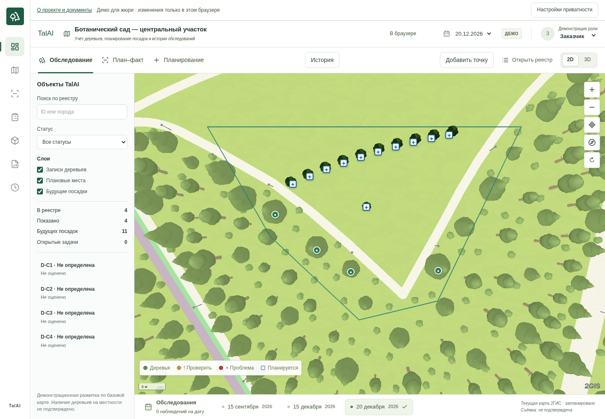
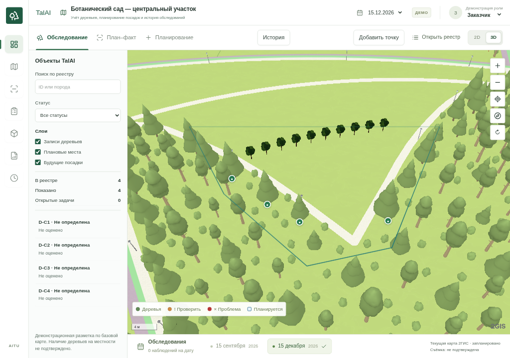
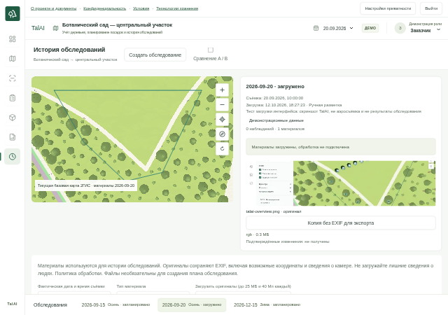

<div align="center">

# TalAI

### Учёт деревьев, планирование посадок и история обследований

Картографический прототип для работы с городскими зелёными территориями.

**[Посмотреть интерфейс ↓](#интерфейс) · [Сценарий для жюри](#попробовать-за-3-минуты) · [Запустить демо](#быстрый-запуск) · [Развернуть на Vercel](DEPLOYMENT.md)**

</div>

> **Онлайн-демо:** ссылка появится здесь после первого успешного развёртывания на Vercel. Пока ниже доступны реальные скриншоты и запуск одной командой после установки зависимостей.
<!-- После проверки деплоя замените строку выше на: **[Открыть TalAI →](https://ВАШ-ПРОВЕРЕННЫЙ-ДОМЕН)**. Тот же адрес укажите в GitHub → About → Website. -->

## Зачем TalAI

Карта показывает, **где находится запись о дереве**, планирование — **где предполагается посадка**, история — **что действительно было зафиксировано в конкретную дату**. Эти данные разделены: будущая посадка не становится существующим деревом, а запланированное обследование — готовым результатом.

Демонстрационная территория — компактный центральный участок Ботанического сада в Астане. Это учебная разметка, не официальный реестр и не заявление о сотрудничестве с садом или городскими органами.

## Интерфейс



| Собственные 3D-посадки | История обследований |
| --- | --- |
|  |  |

Снимки сделаны в приложении; на общем виде добавлена одна тестовая посадка. Материалы в скриншоте истории — тест загрузки, не реальные результаты облёта. В чистом демо обследования не содержат вымышленных фотографий.

## Попробовать за 3 минуты

1. Откройте демо и нажмите **«Принимаю · загрузить карту»** в небольшом уведомлении. Можно отказаться и посмотреть реестр без внешней карты.
2. На **«Территории»** найдите контур участка: 4 демонстрационные записи и 10 будущих посадок. Числа вычисляются из данных.
3. Откройте **«3D-планирование»**, выберите посадку, измените высоту или ширину кроны. Переместите её по карте либо введите координаты. Отключите слой будущих посадок — собственные модели исчезнут.
4. В **«Истории»** выберите дату и сравните два обследования. Отсутствующие материалы показаны явно; будущие даты не содержат готовых результатов.
5. Перезагрузите страницу: изменения демопроекта остаются в вашем браузере. В **«Данных и отчётах»** можно экспортировать JSON/CSV или сбросить демо.

Пароль для публичного демо не нужен. Ничьи рабочие данные в него не копируются.

## Что работает

| Возможность | Состояние |
| --- | --- |
| Карта 2ГИС, граница участка, режимы 2D/3D | Работает при действующем ключе 2ГИС |
| Собственные GLB через официальный glTF-плагин | Выбор, перемещение, размеры, удаление, слой |
| Реестр деревьев и отдельные наблюдения | Устойчивые ID, источники и даты |
| Обследования и сравнение дат | Создание записей, изоляция материалов по датам |
| JSON/CSV-экспорт | Работает в демо и серверном режиме |
| Оригиналы снимков, превью, SQLite | В закрытом серверном режиме |
| Распознавание деревьев, диагностика, 3D-реконструкция | Не подключены; результаты не имитируются |

**Два режима:** публичное демо хранит изменения только в браузере и отключает приём файлов. Закрытая рабочая версия использует авторизацию оператора, SQLite и каталог оригиналов. Vercel-конфигурация развёртывает только демо.

## Быстрый запуск

Нужны Node.js **22.13+** и npm.

```bash
git clone https://github.com/me11r/TalAI.git
cd TalAI
npm ci
cp .env.example .env.local
# Укажите VITE_2GIS_API_KEY в .env.local
npm run dev:demo
```

Откройте адрес, напечатанный Vite в терминале (обычно `http://127.0.0.1:5173`). Без ключа реестр доступен, но карта не загрузится. Браузерный ключ должен разрешать нужный origin и сервисы карты; не помещайте в `VITE_*` серверные пароли.

```bash
npm run build:demo
npm run preview:demo
```

Для рабочего режима с серверным сохранением: [инструкция и архитектура](ARCHITECTURE.md#подготовка-публичного-запуска-12102026). Команда `npm run dev` запускает именно закрытый сервер, а не публичное демо.

## Технологии и устройство

React 19 · TypeScript · Vite · 2GIS MapGL · официальный glTF-плагин · собственная GLB-модель. Серверный режим: Node.js, SQLite, файловое хранилище, Sharp для проверки изображений.

- `src/Map.tsx` — карта и независимые слои.
- `src/territory.ts` — граница участка и демонстрационная география.
- `src/SurveyHistory.tsx` — обследования и сравнение дат.
- `src/persistence.ts` — сохранение; режимы демо и сервера разделены.
- `server.mjs`, `security.mjs` — закрытый API, сессии и проверка загрузок.
- `public/models/talai-tree.glb` — собственная модель; генератор в `scripts/create-tree.mjs`.

## Проверка и документация

```bash
npm test
npm run build:demo
npm run build
```

Браузерные проверки, включая карту, требуют Chrome и работающего ключа. Тест публичного демо: `node scripts/demo-check.mjs`. Он сам собирает демо и запускает отдельный preview-сервер. Серверные сценарии описаны в [архитектуре](ARCHITECTURE.md).

- [Развёртывание на Vercel и оформление GitHub](DEPLOYMENT.md)
- [Техническое описание и перенос старых сохранений](ARCHITECTURE.md)
- [Аудит приватности, защиты и открытые вопросы](LAUNCH_REVIEW.md)
- [Лицензии и атрибуция сторонних компонентов](THIRD_PARTY_NOTICES.md)

Цель доступности — WCAG 2.2 AA; полное соответствие не заявляется. Документы доступны в приложении, а неизвестные реквизиты отмечены явно. Настройки приватности позволяют изменить выбор карты в любой момент.

## Контакт

**TalAI** · [+7 775 330 51 72](tel:+77753305172) · [Написать в WhatsApp](https://wa.me/77753305172)
